<!-- Header banner -->
<p align="center">
  
</p>

<!-- Typing animation -->
<p align="center">
  <a href="https://github.com/afri-bit">
    
  </a>
</p>

<p align="center">
  
  
  
</p>

<br/>

<!-- About -->
<h2 align="center">⚡ Who Am I? ⚡</h2>

<p align="center">
  
</p>

<p align="center">
  <b>I bring vision to product: taking an idea from the first spark to something people can actually use. 🎯</b>
</p>

I'm a Senior Software Engineer, but code is only one part of what I do. I care about the whole journey from **idea → vision → architecture → shipped product**. 🚀  
I define the problem, shape the vision, make the technical decisions, and build it until it's real. Great ideas are everywhere; I'm here to turn them into products.

*(And 'Every Bit' is how you pronounce my nickname 😸)*

```python
class Afrizal:
    def __init__(self):
        self.nickname = "afri-bit"            # pronounced "Every Bit"
        self.role     = "Senior Software Engineer"
        self.mission  = "Bring vision to product"
        self.process  = ["Idea", "Vision", "Design", "Build", "Ship", "Iterate"]
        self.learning = ["Rust 🦀", "Go 🐹"]

    def ready_to_collaborate(self) -> bool:
        return True  # got an idea worth building? let's talk.
```

<br/>

<!-- Products -->
<h2 align="center">🧭 From Idea to Product 🧭</h2>

<p align="center">
  
</p>

<h3 align="center">🛠️ What I'm Working On</h3>

<p align="center">
  
  
  
</p>

<p align="center"><i>👀 More details coming soon. Stay tuned!</i></p>

<br/>

<!-- Connect -->
<h2 align="center">🔗 Let's Connect & Collaborate 🔗</h2>

<p align="center">
  <a href="https://instagram.com/afribit.tech"></a>
  <a href="https://x.com/afri_bit"></a>
  <a href="mailto:afribit.tech@gmail.com"></a>
</p>

<br/>

<!-- Tech stack -->
<h2 align="center">💻 Things I Code With 💻</h2>

<p align="center">
  
</p>

<h3 align="center">🤖 AI Tools & Editors</h3>

<p align="center">
  
</p>

<h3 align="center">🌱 Currently Learning</h3>

<p align="center">
  
</p>

<br/>
<!-- Snake -->
<h2 align="center">🐍 Snake Eats My Contributions 🐍</h2>

<picture>
  <source
    media="(prefers-color-scheme: dark)"
    srcset="https://raw.githubusercontent.com/afri-bit/afri-bit/output/github-contribution-grid-snake-dark.svg"
  />
  <source
    media="(prefers-color-scheme: light)"
    srcset="https://raw.githubusercontent.com/afri-bit/afri-bit/output/github-contribution-grid-snake.svg"
  />
  
</picture>

<br/>
<br/>

<!-- Quote -->
<p align="center">
  
</p>

<!-- Support -->
<h2 align="center">🤝 Support Me 🤝</h2>

<p align="center">
  <a href="https://www.patreon.com/afri_bit"></a>
  <a href="https://buymeacoffee.com/afri.bit"></a>
  <a href="https://www.paypal.com/paypalme/afribit"></a>
  <a href="https://github.com/sponsors/afri-bit"></a>
</p>

<!-- Footer -->
<p align="center">
  
</p>
